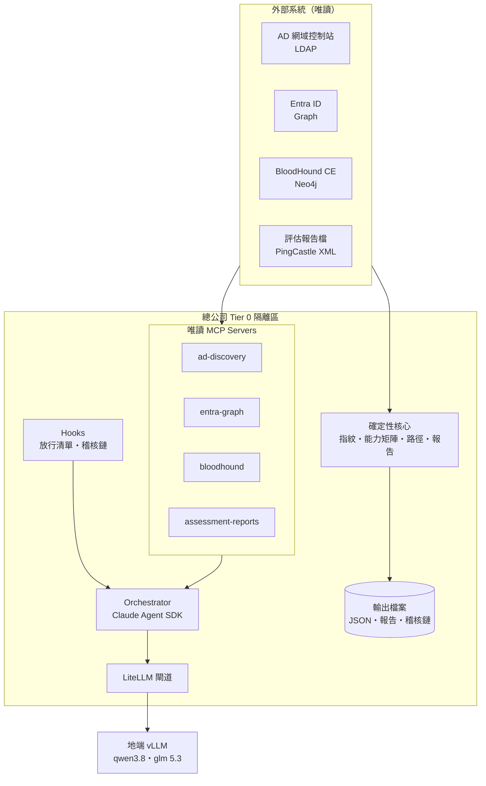

# 架構

完整的專案計畫書與架構圖在 Claude Docs 的《AD 與 Entra ID 混合環境 AI 資安防護專案計畫書》，本文件記錄程式層面的設計決策。

## 分層

## 設計決策

**1. 確定性核心與 LLM 分離。** 弱點與路徑「是否存在」由程式判定，LLM 只解釋與排序。
報告由 `report.py` 直接產生，不經 LLM 改寫，避免數字或帳號名稱被捏造。

**2. 先偵測、後運行。** `discovery.py` 產出指紋，`capability.py` 依 `config/capability_matrix.yaml`
判定 Profile、啟用模組、缺口與額外 Tier 0。規則以 YAML 維護，新增模組或調整門檻不需改程式。
Agent 層也依能力矩陣決定掛哪些子代理與 MCP Server（例如無 Entra 租戶就不掛 `entra-graph`）。

**3. 後端抽象。** mock 與 live 輸出同一套 Pydantic 模型（`models.py`），下游不知道資料來源。
live 環境未接 BloodHound 時，`graph_builder.py` 會由快照推導基本圖譜（缺 ACL 與 Session 邊）。

**4. 修補順序用貪婪重算，不用中心性估計。** `paths.py` 每輪實際移除一條邊並重算可達來源，
選切斷最多者，再對剩餘路徑重複。特權群組成員視為 Tier 0 目標而非攻擊來源。

**5. 四道防線讓 Agent 只能讀。** MCP 只實作讀取 → `allowed_tools` / `disallowed_tools` / `tools` /
`strict_mcp_config` → PreToolUse 放行清單 → `permission_mode="dontAsk"`。
任何一道失效，其他仍會擋下。

**6. 模型路由。** 子代理以 `haiku` / `sonnet` 別名宣告，經 `ANTHROPIC_DEFAULT_HAIKU_MODEL` /
`ANTHROPIC_DEFAULT_SONNET_MODEL` 對應到 `settings.models.fast` / `reason`，再由 LiteLLM 轉到 vLLM。

## 測試策略

- 模擬資料固定種子產生，測試直接斷言埋入的弱點會被找到（例如 hq 第一步修補必為 ESC1）。
- `tests/stub_llm.py` 是 Anthropic Messages 相容樁，讓 Agent SDK 實際啟動 MCP 子行程、
  觸發 Hooks、寫入稽核鏈，驗證整條管線而不需要真模型。
- 上線前另需以真實模型跑評測集（工具呼叫準確率、查詢生成正確率、摘要忠實度、注入抵抗力）。
